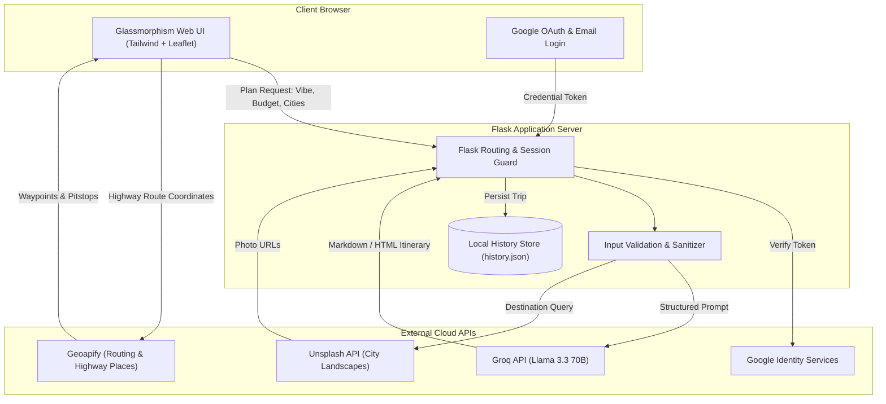

# 🌍 WanderIndia — Smart AI Travel & Route Planner

<div align="center">


**Discover Incredible India with AI-powered personalized itineraries and real-time highway pitstop navigation.**

[Features](#-key-features) • [Tech Stack](#-tech-stack) • [System Architecture](#-system-architecture) • [Getting Started](#-getting-started) • [Environment Setup](#-environment-variables) • [License](#-license)

</div>

---

## 📖 Overview

**WanderIndia** is an intelligent travel planning web platform engineered specifically for travelers exploring India. It bridges the creative power of Large Language Models (**Groq / Llama 3.3 70B**) with spatial mapping APIs (**Geoapify & Leaflet.js**) wrapped inside a sleek, modern Glassmorphism interface.

Whether you're planning a budget weekend getaway from Bangalore or a road trip from Delhi to Leh Ladakh, WanderIndia crafts structured day-by-day itineraries and tracks highway pitstops—from legendary dhabas and fuel stops to scenic viewpoints—strictly along your driving corridor.

---

## ✨ Key Features

- **🤖 AI-Powered Itineraries:** Generates point-wise, highly actionable daily schedules based on budget, mood/vibe, and trip duration using Groq's high-speed inference engine.
- **🗺️ "On The Go" Highway Scanner:** Computes the fastest highway route between source and destination, mathematically sampling stops along the exact corridor to discover verified Stays, Food, Fuel, and Attractions.
- **🛡️ 15km City Geofencing:** Employs mathematical buffer exclusion zones around trip origin and destination points, eliminating in-city clutter and focusing strictly on en-route highway highlights.
- **📍 Instant Google Maps Directions:** Generates direct, multi-stop Google Maps navigation links with a single click.
- **🔐 Flexible Authentication:** Sign in using seamless one-click Google OAuth 2.0 or local email login.
- **📄 Export & Save:** Export generated itineraries to formatted, print-ready PDFs or capture high-res snapshot PNGs of route maps.
- **🎨 Glassmorphism Dark UI:** Immersive, distraction-free visual design built with Tailwind CSS, animated backdrops, and responsive layouts.

---

## 🛠️ Tech Stack

| Layer | Technology |
|---|---|
| **Backend Framework** | Python 3, Flask, Werkzeug |
| **Frontend & Styling** | HTML5, Tailwind CSS, Vanilla JavaScript (ES6+), Jinja2 |
| **AI Inference** | [Groq Cloud](https://groq.com) running `llama-3.3-70b-versatile` |
| **Maps & Routing** | [Leaflet.js](https://leafletjs.com/), [Geoapify](https://www.geoapify.com/) Routing & Places API |
| **Authentication** | Google Identity Services (GIS OAuth 2.0) & Session Auth |
| **Imagery** | [Unsplash API](https://unsplash.com/developers) (Dynamic landscape photography) |
| **Client Utilities** | `html2pdf.js`, `html2canvas` |
| **Testing** | `pytest` (30 route & security tests) |

---

## 🏗️ System Architecture



---

## 🚀 Getting Started

### 1. Prerequisites
Ensure you have the following installed on your machine:
- **Python 3.10+** (Tested on Python 3.13)
- `git`
- `pip`

### 2. Clone the Repository
```bash
git clone https://github.com/<YOUR-USERNAME>/<YOUR-REPO-NAME>.git
cd <YOUR-REPO-NAME>
```

### 3. Create & Activate Virtual Environment
```bash
# macOS / Linux
python3 -m venv venv
source venv/bin/activate

# Windows
python -m venv venv
venv\Scripts\activate
```

### 4. Install Dependencies
```bash
pip install -r requirements.txt
```

### 5. Configure Environment Variables
Copy `.env.example` to `.env`:
```bash
cp .env.example .env
```
Open `.env` and fill in your API credentials (see [Environment Variables](#-environment-variables) below).

### 6. Run the Application
```bash
python main.py
```
Open your browser and navigate to:
```
http://localhost:8000
```
*(Always use `http://localhost:8000` instead of `127.0.0.1` to ensure Google OAuth functions properly).*

---

## ⚙️ Environment Variables

Create a `.env` file in the root directory:

```env
# Flask Session Security Key (any 32+ hex characters)
FLASK_SECRET_KEY=your_generated_secret_key_here

# Groq LLM API Key (Required for AI itinerary generation)
GROQ_API_KEY=gsk_your_groq_api_key_here

# Geoapify API Key (Required for map routes and pitstop scanning)
GEOAPIFY_KEY=your_geoapify_key_here

# Unsplash API Access Key (Optional: for destination landscape photos)
UNSPLASH_ACCESS_KEY=your_unsplash_access_key_here

# Google OAuth Client ID (Optional: for Google login)
GOOGLE_CLIENT_ID=your_google_client_id_here
```

### 🔑 Obtaining API Keys
- **Groq API**: Get a free API key at [console.groq.com](https://console.groq.com)
- **Geoapify**: Sign up for a free tier key at [geoapify.com](https://www.geoapify.com/)
- **Unsplash API**: Register an app at [unsplash.com/developers](https://unsplash.com/developers)
- **Google Client ID**: Configure OAuth credentials at [console.cloud.google.com](https://console.cloud.google.com)

---

## 🧪 Running Tests

The test suite covers route handlers, authentication flows, and security sanitization:

```bash
pytest
```

---

## 📂 Project Structure

```text
WanderIndia/
├── main.py              # Main Flask application and backend API routes
├── models.py            # Data structures and schemas
├── utils.py             # Security sanitization, budget validation, HTML scrubbers
├── requirements.txt     # Python package dependencies
├── .env.example         # Environment template
├── .gitignore           # Git ignore configuration
├── templates/
│   ├── login.html           # Authentication portal (Google OAuth & Email)
│   ├── dashboard.html       # Interactive trip parameters planner
│   ├── recommendations.html # AI destination cards
│   ├── itinerary.html       # Daily scheduled itinerary view & PDF export
│   ├── on_the_go.html       # Live highway Leaflet map scanner
│   ├── history.html         # Saved trips ledger
│   └── 404.html             # Custom error handler page
└── tests/
    └── test_routes.py       # Comprehensive pytest suite (30 test cases)
```

---

## 🛡️ Security & Privacy

- Input sanitization strips dangerous tags and prevents prompt injection attacks.
- Strict `.gitignore` prevents `.env` and local `history.json` databases from leaking into version control.
- Safe session signing protects user state across page navigations.

---

## 📄 License

This project is licensed under the **MIT License**. See the [LICENSE](LICENSE) file for full details.
